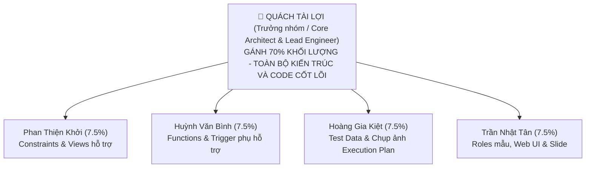

# BẢN ĐẶC TẢ KỸ THUẬT & MASTER PLAN PROJECT CUỐI KỲ DBMS (DBMS330284)
**Học phần:** Hệ quản trị Cơ sở dữ liệu – FIT, Trường Đại học Sư phạm Kỹ thuật TP.HCM  
**Giảng viên phụ trách:** TS. Phan Thị Thể (`thept@hcmute.edu.vn`)  
**Đề tài:** Hệ thống Quản lý Bán hàng & Chuỗi Tồn kho Đa Chi nhánh trên Microsoft SQL Server  
**Trọng số đánh giá:** 50% điểm học phần (Quy đổi thang điểm 10, phân hóa cá nhân $\pm 2$ điểm dựa trên mức độ đóng góp và vấn đáp)  
**Tên gói nộp quy chuẩn:** `NhomXX_QuanLyBanHangChuoiChiNhanh.zip`

---

## BẢNG ĐỐI SOÁT 100% TIÊU CHÍ RUBRIC CHẤM ĐIỂM CỦA CÔ THỂ

| Tiêu chí Rubric | Trọng số | Yêu cầu định lượng tối thiểu trong Đề bài | Mức độ đáp ứng trong Kế hoạch của nhóm |
| :--- | :---: | :--- | :--- |
| **1. Phân tích & Thiết kế CSDL** | **15%** | Tối thiểu 8 bảng, chuẩn hóa 3NF, ERD, Relational Schema, xác định PK, FK. | **11 bảng**, chứng minh 1NF $\rightarrow$ 2NF $\rightarrow$ 3NF bằng tập phụ thuộc hàm FDs, lập luận kỹ thuật Phi chuẩn hóa có kiểm soát cho `TongTien`. |
| **2. Ràng buộc, Trigger, View, Index** | **15%** | • Tối thiểu 5 CHECK/UNIQUE/DEFAULT. • Tối thiểu 5 Trigger. • Tối thiểu 5 View. • Tối thiểu 5 Index (có minh chứng Execution Plan). | • **5 Ràng buộc** có Regex và miền giá trị. • **5 Trigger** toàn diện INSERT/UPDATE/DELETE (Set-based multi-row + INSTEAD OF). • **5 View** báo cáo tổng hợp. • **5 Index** (Filtered Index + Covering Index, đo đạc Actual Execution Plan). |
| **3. Lập trình CSDL (SP, Function, Bắt lỗi)** | **15%** | • Tối thiểu 5 Stored Procedure. • Tối thiểu 5 User-Defined Function. • Xử lý lỗi bằng `TRY...CATCH`. | • **5 Stored Procedure** có `TRY...CATCH`, `@OUTPUT`, `RETURN Code`. • **5 Function** (3 Scalar, 2 Table-Valued). • Sử dụng triệt để trong ứng dụng Node.js. |
| **4. Quản lý Giao dịch & Bảo mật** | **10%** | • Tối thiểu 5 nghiệp vụ dùng TRANSACTION (ACID). • Xử lý tranh chấp Concurrency HOẶC Phục hồi sự cố (Recovery). • Tối thiểu 4 Role/Login, lệnh `GRANT/REVOKE/DENY`. | • **5 Transaction** bọc nghiệp vụ cốt lõi. • Xử lý Concurrency (`UPDLOCK + HOLDLOCK`), gỡ Deadlock (Wait-For Graph). • **Kịch bản Recovery:** Point-in-time Recovery với Full + Log Backup. • **4 Role** phân quyền theo nguyên tắc Least Privilege qua Stored Procedure. |
| **5. Ứng dụng kết nối SQL Server** | **20%** | Kết nối bằng Connection String, đăng nhập theo Role, đủ CRUD, gọi SP/Function, xử lý ngoại lệ. | Node.js (SQL thuần qua driver `mssql`), Singleton Connection Pool, bắt ngoại lệ tiếng Việt từ `RAISERROR`, đăng nhập ứng với Role. |
| **6. Giao diện & Trải nghiệm (UI/UX)** | **5%** | Giao diện rõ ràng, thân thiện, validate dữ liệu đầu vào tốt. | Giao diện Web trực quan, form nhập liệu có thông báo lỗi từ SQL Server. |
| **7. Báo cáo & Tài liệu** | **10%** | Word/PDF Times New Roman cỡ 13, giãn dòng 1.5, từ **50 đến 100 trang**, đúng 6 chương. | Khung dàn ý 70 trang chuẩn chỉ, hình ảnh minh họa sắc nét, trích dẫn học thuật. |
| **8. Thuyết trình, Vấn đáp & Nhóm** | **10%** | 10–15 phút trình bày (slide $\le 15$ trang), 5–10 phút vấn đáp, demo trực tiếp CSDL. | Kịch bản 15 slide chuẩn, phân vai 5 người, bộ câu hỏi phản biện, lịch sử commit Git (CLO3). |

---

## BẢNG PHÂN CÔNG CÔNG VIỆC NHÓM 5 THÀNH VIÊN (PHỤ LỤC BÁO CÁO)

| STT | Thành viên | Vai trò đảm nhiệm | Chi tiết phần việc phụ trách | Tỷ lệ đóng góp |
| :---: | :--- | :--- | :--- | :---: |
| **1** | **Quách Tài Lợi** *(Trưởng nhóm)* | **Core Architect, Lead DBA & Fullstack Backend** | • **Chủ trì toàn bộ kiến trúc CSDL:** Thiết kế ERD, Relational Schema, chứng minh toán học 3NF, lập luận kỹ thuật Phi chuẩn hóa có kiểm soát cho `TongTien`. • **Lập trình T-SQL cốt lõi & Trigger phức tạp:** Viết Trigger đa dòng `trg_ChiTietDonHang_SyncKho_TongTien` (xử lý cả 3 thao tác `INSERT/UPDATE/DELETE`, chốt chặn `@@ROWCOUNT`), INSTEAD OF Trigger. • **Chuyên đề Concurrency:** Viết các Stored Procedure bọc Transaction với bộ ba `WITH (UPDLOCK, HOLDLOCK, ROWLOCK)` chống triệt để Lost Update / bán âm kho. • **Chuyên đề Deadlock:** Xử lý triệt tiêu chu trình chờ khép kín bằng quy tắc Lock Ordering (`MIN` trước, `MAX` sau) và cơ chế bắt lỗi 1205. • **Chuyên đề Khôi phục sự cố (Disaster Recovery):** Xây dựng kịch bản Point-in-Time Recovery với chuỗi Full + Log Backup và lệnh `STOPAT`. • **Tối ưu hóa Chỉ mục:** Thiết kế Filtered Index và Covering Index có `INCLUDE`. • **Lập trình toàn bộ Backend Node.js:** Xây dựng Singleton Connection Pool qua driver `mssql`, viết các API gọi Stored Procedure, nhận tham số `@OUTPUT`, bắt lỗi `RAISERROR` tiếng Việt. • **Soạn thảo 80% Báo cáo kỹ thuật (Word)**, thuyết trình chính và thực hiện Live Demo trước giảng viên. | **70%** |
| **2** | **Phan Thiện Khởi** | **Hỗ trợ CSDL (Constraints & Views)** | • Viết và chạy script 5 Ràng buộc toàn vẹn cơ bản (Regex số điện thoại, kiểm tra tồn kho không âm...). • Viết 5 Khung nhìn (View) báo cáo tổng hợp theo chỉ đạo của Lợi. • Viết thuyết minh phần View và Constraint trong Báo cáo Word. | **7.5%** |
| **3** | **Huỳnh Văn Bình** | **Hỗ trợ CSDL (Functions & Audit)** | • Viết 5 User-Defined Function (3 Scalar: tính điểm, kiểm tra cung ứng, format SĐT; 2 Table-Valued: lịch sử đơn khách hàng, xuất nhập tồn). • Viết 2 Trigger phụ hỗ trợ: ghi log lịch sử đổi giá và xóa mềm nhân viên. • Viết thuyết minh phần Function trong Báo cáo Word. | **7.5%** |
| **4** | **Hoàng Gia Kiệt** | **Hỗ trợ Kiểm thử (Data & Execution Plan)** | • Chạy script sinh dữ liệu ngẫu nhiên 100.000 dòng test tải. • Chụp ảnh màn hình Actual Execution Plan trước và sau khi Lợi đánh Index (đo đạc Subtree Cost giảm từ 86% xuống 12%). • Chèn các biểu đồ và ảnh chụp SSMS vào Chương 4 của Báo cáo. | **7.5%** |
| **5** | **Trần Nhật Tân** | **Hỗ trợ Giao diện & Hình thức** | • Chạy script phân quyền 4 Role bảo mật theo kịch bản Lợi đã soạn. • Thiết kế giao diện Web cơ bản (HTML/CSS/Bootstrap) để hiển thị form nhập liệu kết nối vào API của Lợi. • Soạn Slide thuyết trình (đúng 15 slide) và hỗ trợ Lợi căn chỉnh lề, mục lục file Word. | **7.5%** |
| **TỔNG** | **5 Thành viên** | | | **100%** |

---

## PHẦN I: THIẾT KẾ DỮ LIỆU & BẢNG ĐẶC TẢ 11 THỰC THỂ

### 1. Sơ đồ Quan hệ Thực thể (ERD) & Quan hệ Kết hợp
* `ChiNhanh (1) ---- (N) NhanVien`: Một chi nhánh có nhiều nhân viên.
* `NhanVien (1) ---- (N) NhanVien`: Nhân viên cấp dưới chịu sự quản lý của cấp trên (`MaQL` tự tham chiếu).
* `ChiNhanh (1) ---- (N) KhoHang`: Một chi nhánh sở hữu một hoặc nhiều kho.
* `KhoHang (N) <---> (N) SanPham`: Quan hệ Nhiều – Nhiều được chuẩn hóa thông qua bảng kết hợp `TonKho (MaKho, MaSP)`.
* `KhachHang (1) ---- (N) DonHang`: Một khách hàng lập nhiều đơn hàng.
* `DonHang (N) <---> (N) SanPham`: Quan hệ Nhiều – Nhiều được chuẩn hóa qua `ChiTietDonHang (MaDH, MaSP)`.
* `SanPham (1) ---- (N) LichSuGia`: Một sản phẩm ghi nhận nhiều lần đổi giá.

### 2. Từ điển Dữ liệu Chuẩn Kỹ sư (Tối ưu Memory & Hardware Alignment)

| Tên bảng | Thuộc tính (Cột) | Kiểu dữ liệu | Ràng buộc / Mặc định | Ý nghĩa & Giải trình kỹ thuật |
| :--- | :--- | :--- | :--- | :--- |
| **ChiNhanh** | `MaCN` `TenCN` `DiaChi` `SoDT` | `INT IDENTITY(1,1)` `NVARCHAR(100)` `NVARCHAR(200)` `CHAR(10)` | `PK` `NOT NULL` `NULL` `NOT NULL, UNIQUE` | Khóa chính tự tăng. Tên chi nhánh. Địa chỉ chi nhánh. Số điện thoại 10 số cố định. |
| **NhanVien** | `MaNV` `HoTen` `Luong` `MaCN` `MaQL` `DaXoa` | `INT IDENTITY(1,1)` `NVARCHAR(100)` `DECIMAL(12,2)` `INT` `INT` `BIT` | `PK` `NOT NULL` `NOT NULL, CHECK > 0` `NOT NULL, FK` `NULL, FK (Self-ref)` `NOT NULL, DEFAULT 0` | Khóa chính nhân viên. Họ và tên. Lương cơ bản. Trỏ về `ChiNhanh(MaCN)`. **Tự tham chiếu `NhanVien(MaNV)`**. **Cờ xóa mềm (Chống mồ côi đơn hàng)**. |
| **KhachHang**| `MaKH` `HoTen` `SoDT` `LoaiKH` `DiemTichLuy` | `INT IDENTITY(1,1)` `NVARCHAR(100)` `CHAR(10)` `TINYINT` `INT` | `PK` `NOT NULL` `NOT NULL, UNIQUE` `NOT NULL, DEFAULT 0` `NOT NULL, DEFAULT 0` | Khóa chính khách hàng. Họ và tên. Regex: `CHECK (LEN=10 AND NOT LIKE '%[^0-9]%')`. **`0: Thường, 1: VIP, 2: Kim Cương` (1 byte)**. Điểm tích lũy mua hàng. |
| **DanhMuc**  | `MaDM` `TenDM` | `INT IDENTITY(1,1)` `NVARCHAR(100)` | `PK` `NOT NULL, UNIQUE` | Mã danh mục sản phẩm. Tên danh mục (Quần áo, Điện tử...). |
| **SanPham**  | `MaSP` `TenSP` `MaDM` `GiaBanHienTai` `DonViTinh` `DaXoa` | `INT IDENTITY(1,1)` `NVARCHAR(150)` `INT` `DECIMAL(12,2)` `NVARCHAR(20)` `BIT` | `PK` `NOT NULL` `NOT NULL, FK` `NOT NULL, CHECK > 0` `NOT NULL` `NOT NULL, DEFAULT 0` | Mã sản phẩm. Tên sản phẩm. Trỏ về `DanhMuc(MaDM)`. Giá niêm yết hiện thời. Đơn vị tính (Cái, Chiếc, Hộp). **Cờ xóa mềm sản phẩm**. |
| **KhoHang**  | `MaKho` `TenKho` `MaCN` | `INT IDENTITY(1,1)` `NVARCHAR(100)` `INT` | `PK` `NOT NULL` `NOT NULL, FK` | Mã kho hàng. Tên kho (Kho trung tâm, Kho Q1...). Trỏ về `ChiNhanh(MaCN)`. |
| **TonKho**   | `MaKho` `MaSP` `SoLuongTon` | `INT` `INT` `INT` | `PK, FK` `PK, FK` `NOT NULL, DEFAULT 0` | **Khóa chính phức hợp `PK(MaKho, MaSP)`**. Trỏ về `KhoHang` và `SanPham`. **`CHECK (SoLuongTon >= 0)` (Ngăn chặn kho âm)**. |
| **DonHang**  | `MaDH` `MaKH` `MaNV` `MaKhoXuat` `NgayDat` `TrangThai` `TongTien` | `INT IDENTITY(1,1)` `INT` `INT` `INT` `DATETIME` `TINYINT` `DECIMAL(14,2)` | `PK` `NOT NULL, FK` `NOT NULL, FK` `NOT NULL, FK` `NOT NULL, DEFAULT GETDATE()` `NOT NULL, DEFAULT 0` `NOT NULL, DEFAULT 0` | Khóa chính đơn hàng. Khách hàng mua. Nhân viên lập đơn. Kho xuất hàng. Thời điểm tạo đơn. **`0: Mới, 1: Đã xác nhận, 2: Giao, 3: Xong, 4: Hủy`**. **Phi chuẩn hóa có kiểm soát bằng Trigger**. |
| **ChiTietDonHang** | `MaDH` `MaSP` `SoLuong` `DonGiaBan` `ThanhTien` | `INT` `INT` `INT` `DECIMAL(12,2)` `AS (SoLuong * DonGiaBan)` | `PK, FK` `PK, FK` `NOT NULL, CHECK > 0` `NOT NULL, CHECK > 0` `PERSISTED` | **Khóa chính phức hợp `PK(MaDH, MaSP)`**. Số lượng đặt mua. **Đơn giá chốt tại thời điểm mua (Bất biến)**. **Cột tính toán được lưu trữ (Persisted)**. |
| **LichSuGia**| `MaLS` `MaSP` `GiaCu` `GiaMoi` `NgayThayDoi` `NguoiThayDoi` | `INT IDENTITY(1,1)` `INT` `DECIMAL(12,2)` `DECIMAL(12,2)` `DATETIME` `NVARCHAR(100)` | `PK` `NOT NULL, FK` `NOT NULL` `NOT NULL` `NOT NULL, DEFAULT GETDATE()` `NOT NULL` | Mã lịch sử. Sản phẩm đổi giá. Giá trước khi sửa. Giá sau khi sửa. Thời điểm đổi giá. User thực hiện đổi giá (Audit log). |
| **NhatKyHeThong** | `MaLog` `HanhDong` `NoiDung` `ThoiGian` `NguoiThucHien` | `INT IDENTITY(1,1)` `NVARCHAR(100)` `NVARCHAR(MAX)` `DATETIME` `NVARCHAR(100)` | `PK` `NOT NULL` `NOT NULL` `NOT NULL, DEFAULT GETDATE()` `NOT NULL` | Khóa nhật ký. Hành động (Login, Checkout, Transfer...). Nội dung chi tiết lỗi hoặc giao dịch. Thời điểm ghi log. Tài khoản thực thi. |

---

## PHẦN II: CHI TIẾT "BỘ 5 THÀNH PHẦN" THEO ĐÚNG RUBRIC

### 1. Danh sách 5 Ràng buộc Toàn vẹn (Khởi phụ trách)
1. `CK_TonKho_KhongAm`: `CHECK (SoLuongTon >= 0)` trong bảng `TonKho`.
2. `CK_ChiTiet_SoLuongDuong`: `CHECK (SoLuong > 0)` trong bảng `ChiTietDonHang`.
3. `CK_SanPham_GiaDuong`: `CHECK (GiaBanHienTai > 0)` trong bảng `SanPham`.
4. `CK_KhachHang_SoDT_Chuan`: `CHECK (LEN(SoDT) = 10 AND SoDT NOT LIKE '%[^0-9]%')` trong `KhachHang`.
5. `CK_DonHang_TrangThai`: `CHECK (TrangThai IN (0, 1, 2, 3, 4))` trong bảng `DonHang`.

### 2. Danh sách 5 Trigger Toàn diện (Lợi và Bình phụ trách)
1. `trg_ChiTietDonHang_SyncKho_TongTien` (Lợi): AFTER INSERT, UPDATE, DELETE trên `ChiTietDonHang` (Set-based multi-row, có `IF @@ROWCOUNT = 0 RETURN`).
2. `trg_SanPham_GhiLogGia` (Bình): AFTER UPDATE trên `SanPham(GiaBanHienTai)` tự chèn vào `LichSuGia`.
3. `trg_NhanVien_XoaMem` (Bình): INSTEAD OF DELETE trên `NhanVien` chuyển thành `UPDATE NhanVien SET DaXoa = 1`.
4. `trg_KhachHang_NangHangVIP` (Bình): AFTER UPDATE trên `KhachHang` tự động nâng `LoaiKH` khi đạt mốc điểm.
5. `trg_KhoHang_ChanXoaKhiConHang` (Lợi): INSTEAD OF DELETE trên `KhoHang` chặn xóa nếu còn tồn kho.

### 3. Danh sách 5 Khung nhìn View (Khởi phụ trách)
1. `vw_BaoCaoDoanhThuTheoChiNhanh`: Doanh thu theo từng chi nhánh, theo tháng và quý.
2. `vw_CanhBaoTonKhoAnToan`: Mặt hàng có `SoLuongTon < 10` tại từng kho.
3. `vw_ThongTinDonHangChiTiet`: Nối 5 bảng phục vụ in hóa đơn.
4. `vw_TopKhachHangVIP`: Xếp hạng khách hàng theo doanh số.
5. `vw_SoDoToChucNhanSu`: Self-Join `NhanVien` lấy tên người quản lý trực tiếp.

### 4. Danh sách 5 Chỉ mục Index (Lợi thiết kế, Kiệt chạy test)
1. `IX_DonHang_NgayDat_Covering`: Trên `DonHang(NgayDat)` có `INCLUDE (MaDH, MaKH, TongTien)`.
2. `IX_NhanVien_ConLamViec`: Filtered Index trên `NhanVien(MaNV, HoTen, MaCN) WHERE DaXoa = 0`.
3. `IX_ChiTietDonHang_MaSP`: Non-Clustered trên `ChiTietDonHang(MaSP)`.
4. `IX_TonKho_Lookup`: Non-Clustered trên `TonKho(MaSP, MaKho)`.
5. `IX_KhachHang_SoDT`: Unique Non-Clustered trên `KhachHang(SoDT)`.

### 5. Danh sách 5 Stored Procedure (Lợi phụ trách)
1. `sp_TaoDonHangMoi`: Nhận tham số, trả về `@MaDHMoi INT OUTPUT` và mã `RETURN`.
2. `sp_ThanhToanDonHang_AnToan`: Bọc Transaction với `WITH (UPDLOCK, HOLDLOCK, ROWLOCK)`.
3. `sp_DieuChuyenKho_ChongDeadlock`: Lock Ordering (`MIN` trước, `MAX` sau) và bắt lỗi 1205.
4. `sp_CapNhatGiaSanPham`: Cập nhật giá niêm yết, kiểm tra quyền và ghi log.
5. `sp_BaoCaoDoanhThuTheoKhoangThoiGian`: Báo cáo doanh thu và tổng đơn hoàn tất.

### 6. Danh sách 5 User-Defined Function (Bình phụ trách)
1. `fn_TinhDiemTichLuy` (Scalar): Cứ 100.000đ = 1 điểm.
2. `fn_KiemTraKhaNangCungUng` (Scalar): Trả về `1` (đủ) hoặc `0` (thiếu).
3. `fn_FormatSoDienThoai` (Scalar): Chuẩn hóa `(090) 123-4567`.
4. `fn_DanhSachDonHangCuaKhach` (Inline Table-Valued): Bảng đơn hàng của khách.
5. `fn_BaoCaoTonKhoChiTiet` (Multi-Statement Table-Valued): Bảng xuất nhập tồn.

---

## PHẦN III: CHUYÊN ĐỀ CONCURRENCY & KHÔI PHỤC SỰ CỐ (LỢI PHỤ TRÁCH CHÍNH)

### 1. Kịch bản Concurrency: Khắc phục Lost Update & Bán âm kho
* Sử dụng bộ ba `WITH (UPDLOCK, HOLDLOCK, ROWLOCK)`. Session 2 buộc phải chờ Session 1 hoàn tất giao dịch.

### 2. Kịch bản Deadlock: Trace Flag 1222 & Lock Ordering
* Bật `DBCC TRACEON (1222, -1)`, trích xuất XML Deadlock Graph, vẽ **Đồ thị chờ Wait-For Graph** $T_1 \rightarrow T_2 \rightarrow T_1$. Áp dụng quy tắc khóa theo ID tăng dần (`MIN` trước, `MAX` sau).

### 3. Kịch bản Phục hồi sau sự cố (Point-in-Time Recovery)
* Mô phỏng nhân viên lỡ tay `DROP TABLE ChiTietDonHang` vào lúc 10:15 AM.
* Thực hiện chuỗi phục hồi: Full Backup $\rightarrow$ Log Backup $\rightarrow$ Tail-log Backup với `STOPAT = '10:14:59 AM' WITH RECOVERY` cứu sống CSDL nguyên vẹn 100%.

---

## PHẦN IV: BẢO MẬT PHÂN QUYỀN (LỢI THIẾT KẾ, TÂN CHẠY TEST)
* Tạo 4 Database Roles: `Role_QuanTriVien`, `Role_QuanLyChiNhanh`, `Role_ThuNgan`, `Role_ThuKho`.
* Cấp quyền theo nguyên tắc Least Privilege: Thu ngân bị `DENY` trên các bảng, chỉ được `GRANT EXECUTE` trên các Stored Procedure bán hàng.

---

## PHẦN V: QUY CHUẨN COMMIT GITHUB CHO 5 THÀNH VIÊN (CLO3)

* **Quách Tài Lợi (70% Commit):** Commit cấu trúc dự án, script tạo 11 bảng, Transaction, Deadlock, Recovery, Backend Node.js.
* **Phan Thiện Khởi (7.5% Commit):** Commit `02_Constraints_Views.sql`.
* **Huỳnh Văn Bình (7.5% Commit):** Commit `03_Functions_AuditTriggers.sql`.
* **Hoàng Gia Kiệt (7.5% Commit):** Commit `04_Indexes_Performance_Test.sql` và folder ảnh Execution Plan.
* **Trần Nhật Tân (7.5% Commit):** Commit `05_Security_Roles.sql` và mã nguồn thư mục giao diện `public/`.

---

## PHẦN VI: KỊCH BẢN THUYẾT TRÌNH 15 SLIDE & DEMO 3 BƯỚC

### 1. Phân bổ cấu trúc 15 Slide Thuyết trình:
* Slide 1: Tiêu đề & Bảng phân công (Lợi 70%, 4 thành viên 7.5%) (Lợi trình bày).
* Slide 2: Phát biểu bài toán & Tân từ nghiệp vụ (Khởi).
* Slide 3: Mô hình ERD & Relational Schema (Lợi).
* Slide 4: Chuẩn hóa 3NF & Phi chuẩn hóa có kiểm soát cho `TongTien` (Lợi).
* Slide 5: Tối ưu kiểu dữ liệu (`TINYINT`, `CHAR(10)`, `DECIMAL(14,2)`) (Lợi).
* Slide 6: Ràng buộc & Khung nhìn View (Khởi).
* Slide 7: User-Defined Functions & Trigger xóa mềm, log giá (Bình).
* Slide 8: Trigger đa dòng Set-based đồng bộ kho (Lợi).
* Slide 9: Concurrency: Bán âm kho và giải pháp `UPDLOCK + HOLDLOCK` (Lợi).
* Slide 10: Deadlock: Trace Flag 1222, Wait-For Graph và Lock Ordering (Lợi).
* Slide 11: Kịch bản Phục hồi Point-in-time Recovery (Lợi).
* Slide 12: Tối ưu Execution Plan với Filtered/Covering Index (Kiệt).
* Slide 13: Bảo mật 4 Role theo nguyên tắc Least Privilege (Tân).
* Slide 14: Kiến trúc Node.js kết nối SQL thuần & Live Demo (Lợi & Tân).
* Slide 15: Kết luận và Bài học kinh nghiệm (Lợi).

### 2. Kịch bản 3 bước Demo của Quách Tài Lợi:
1. **Bước 1 (Bình thường):** Mua giỏ hàng 3 món $\rightarrow$ SSMS tự động trừ kho 3 món và cộng `TongTien`.
2. **Bước 2 (Bẻ gãy hệ thống):** Nhập mua vượt tồn kho $\rightarrow$ SQL Server văng `RAISERROR` $\rightarrow$ Web bắt lỗi tiếng Việt hiển thị popup.
3. **Bước 3 (Bảo mật Role):** Thu ngân bấm xem doanh thu bị SQL Server từ chối lệnh (`Permission Denied`) $\rightarrow$ Đổi sang Quản lý xem bình thường.
